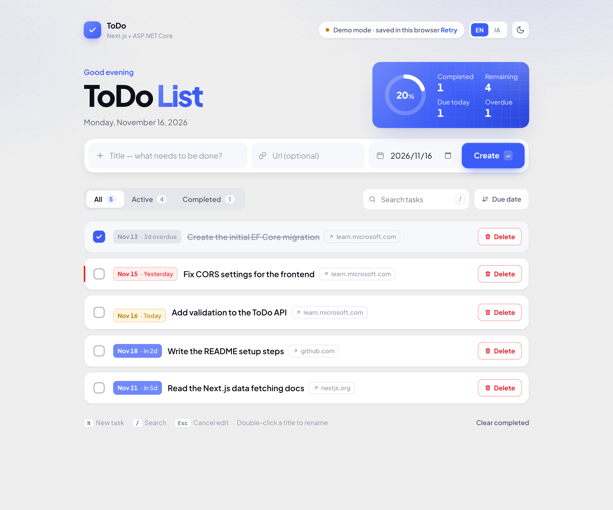

**English** | [日本語](README.ja.md)

# Next.js + TypeScript + ASP.NET Core Todo App

A full-stack Todo application with a decoupled architecture: a Next.js (TypeScript) frontend communicating with an ASP.NET Core Web API, backed by a SQLite database.



## Features

- Create tasks with a title, an optional URL, and a due date
- Mark tasks as complete, rename them (double-click a title), and delete them with **Undo**
- Progress summary: completion ring, plus counts for completed, remaining, due today, and overdue tasks
- Filter tabs (All / Active / Completed), search, and sort by due date
- Due-date badges that highlight tasks due today and overdue tasks
- **English / Japanese** language switch (the `EN` / `JA` toggle in the header)
- Light / dark theme
- Keyboard shortcuts: `N` new task, `/` search, `Esc` cancel edit
- **Demo mode**: if the API cannot be reached, the app keeps working with sample data saved in the browser (`localStorage`)

## Tech Stack

- **Frontend:** Next.js 13 (Pages Router), React 18, TypeScript, axios
- **Backend:** ASP.NET Core 7 Web API, Entity Framework Core
- **Database:** SQLite

## Project Structure

```
.
├── backend/                 ASP.NET Core Web API
│   ├── Controllers/ToDoController.cs
│   ├── Data/ToDoContext.cs
│   ├── Models/ToDoItem.cs
│   ├── Migrations/
│   └── todo.db              SQLite database
├── frontend/                Next.js app (UI)
│   ├── pages/index.tsx      Main page
│   ├── lib/i18n.ts          English / Japanese strings
│   ├── lib/todoUtils.ts     Date, URL, and storage helpers
│   └── styles/globals.css
└── docs/                    Screenshots
```

## Getting Started

### Prerequisites

- [.NET 7 SDK](https://dotnet.microsoft.com/download/dotnet/7.0)
- [Node.js](https://nodejs.org/) 16.8 or later

### 1. Start the backend

```bash
cd backend
dotnet run --launch-profile http
```

The API runs at `http://localhost:5082`. Swagger UI is available at `http://localhost:5082/swagger`.

### 2. Start the frontend

```bash
cd frontend
npm install
npm run dev
```

Open [http://localhost:3000](http://localhost:3000).
The backend allows CORS only from `http://localhost:3000`, so keep the frontend on that port.

## Language

Use the `EN` / `JA` toggle in the header to switch languages. Your choice is saved in the browser.
You can also open a specific language with a query parameter, for example `http://localhost:3000/?lang=ja`.

## API Endpoints

| Method | Path             | Description          |
| ------ | ---------------- | -------------------- |
| GET    | `/api/todo`      | List all tasks       |
| GET    | `/api/todo/{id}` | Get a single task    |
| POST   | `/api/todo`      | Create a task        |
| PUT    | `/api/todo/{id}` | Update a task        |
| DELETE | `/api/todo/{id}` | Delete a task        |

Example task:

```json
{
  "id": 1,
  "title": "Write the README setup steps",
  "url": "https://example.com",
  "dueDate": "2026-11-18T00:00:00",
  "isComplete": false
}
```
